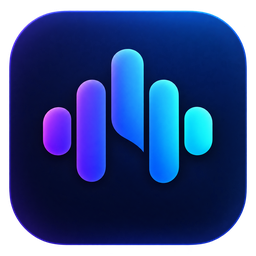

<div align="center">
  
  <h1>Sonvail</h1>
  <p>A Windows desktop music player for your local collection.</p>
  <p>
    
    
    <a href="LICENSE"></a>
    
  </p>
</div>

Sonvail brings your local music, metadata and playback queue into one desktop workspace. Built with **Rust, GPUI and rodio**, it stores library records in SQLite and keeps them synchronized with your music folders through a filesystem watcher.

## Features

- **Local music library:** add multiple folders and discover MP3, WAV, FLAC and OGG files recursively. Overlapping folders do not duplicate tracks.
- **Automatic indexing:** load saved tracks immediately, reconcile folders at startup and update affected folders when files are added, changed, renamed or removed.
- **Rich metadata:** read track titles, multiple artists, albums, album artists, release dates, genres, composers, track/disc numbers, duration and audio properties. Files without readable tags use filename fallbacks.
- **Embedded artwork:** display album covers in Library, Now Playing and the queue, with cached full-size images and small thumbnails.
- **Playback controls:** play, pause, resume, stop, skip, seek by clicking the progress bar, adjust volume and mute. Shuffle and Off/All/One repeat modes are available.
- **Playback queue:** select tracks from Library or the current queue, follow the active track in Now Playing and preview upcoming tracks in Queue and Up Next.
- **Background audio processing:** bounded PCM buffering, file decoding outside the device callback, unreadable-track skipping and audio-output recovery after stream errors.
- **Desktop appearance:** Dark, Light and System themes, translucent Acrylic panels, a custom window titlebar and DPI-aware application icons.
- **Persistent settings and diagnostics:** automatically save the theme and source folders, retain indexed records for temporarily unavailable folders and write daily diagnostic logs.
- **Signed Windows updates:** check for releases in Settings, download with progress and install with a restart through Velopack. Package updates require an initial Setup installation and configured release signing.

Sonvail is under active development. Search, favorites, persistent playlists and the separate Albums/Artists pages are not connected yet. Gapless playback, crossfade, ReplayGain, media keys and output-device selection are also pending. Audio-device behavior and visual layout require manual testing on Windows.

## Getting Started

1. Run Sonvail and open **Settings**.
2. Use **Add folders** to select one or more music folders.
3. Open **Library** and let the initial indexing finish. Later filesystem changes are detected automatically.
4. Click a track to start playback and create a queue from the current library snapshot.
5. Open **Now Playing** to follow the current track, browse the queue and use playback controls. Click **…** to reveal additional track details.

Selecting a new track in Library creates a new queue. New files appear in Library automatically; the membership of an already playing queue stays unchanged. Tag changes update matching queued tracks without restarting playback.

## Development

Windows development requires a Rust toolchain supporting **edition 2024**, the MSVC C++ Build Tools and the Windows SDK. GPUI is pinned to **0.2.2**; dependency versions are recorded in `Cargo.lock`. Python and Pillow are only needed when regenerating the icon exports.

```powershell
git clone https://github.com/Envo1d/sonvail.git
cd sonvail
cargo run --locked
```

The Cargo package and GUI binary are named `audio-player`. The earlier console prototype remains a separate `audio-player-cli` binary; it is not the GUI's playback backend.

### Validation

```powershell
cargo test --locked
cargo fmt --check
cargo clippy --all-targets --locked
```

Automated tests use temporary files and databases, synthetic audio and a fake output device. They do not launch the GUI or play audio through a real device. Manually verify playback, pause/resume, skipping, stop, seeking, repeat/shuffle, empty queues, device reconnection and window behavior.

### Release Builds

```powershell
cargo build --release --locked
```

The GUI executable is written to `target/release/audio-player.exe`. GPUI's Windows release build needs the Windows SDK shader compiler, `fxc.exe`. If it is not discovered automatically, set `GPUI_FXC_PATH` to its installed location before building:

```powershell
$env:GPUI_FXC_PATH = 'C:\Program Files (x86)\Windows Kits\10\bin\10.0.22621.0\x64\fxc.exe'
cargo build --release --locked
```

Replace the SDK version in the example with the version installed on your machine.

Windows Setup and update packages are prepared by `scripts/build-windows.ps1`. Packaging requires Node.js 24, .NET 8 and a separate Sonvail Ed25519 signing key. Generate a key outside the repository with `node scripts/updater-signing.mjs generate <private-key-path>`, set `SONVAIL_UPDATER_PUBLIC_KEY` to the contents of the generated `.pub` file, and pass `-SigningKeyPath` when packaging.

The Windows release workflow runs on `main`, checks the version in `Cargo.toml` against `Cargo.lock` and existing releases, then publishes a complete signed release. Configure the repository variable `SONVAIL_UPDATER_PUBLIC_KEY` and secret `SONVAIL_SIGNING_PRIVATE_KEY` (private PEM contents) before using it. Keep the same signing key for future releases. Standalone development executables cannot use package updates. Installer and end-to-end update behavior still require manual Windows verification.

## Local Data

Sonvail keeps your music files in their original folders. Removing a source folder from Settings removes its library records without deleting your music.

For a new Windows installation, application data is stored in:

| Data | Location |
| --- | --- |
| Settings | `%APPDATA%\Envo1d\Sonvail\config\settings.json` |
| Library database | `%LOCALAPPDATA%\Envo1d\Sonvail\data\library.sqlite3` |
| Artwork cache | `%LOCALAPPDATA%\Envo1d\Sonvail\data\artwork` |
| Logs | `%LOCALAPPDATA%\Envo1d\Sonvail\data\logs` |

Logs are named `Sonvail.YYYY-MM-DD.log`. Use `RUST_LOG` to adjust diagnostic verbosity, for example:

```powershell
$env:RUST_LOG = 'audio_player=debug'
cargo run --locked
```

## Feedback

Report bugs and request features through **[GitHub Issues](https://github.com/Envo1d/sonvail/issues)**. Include the application version, Windows version and steps to reproduce the issue. For playback or indexing problems, include the file format and relevant log messages.

## License

Sonvail is distributed under the **[MIT License](LICENSE)**. Copyright (c) 2026 Envo1d.
